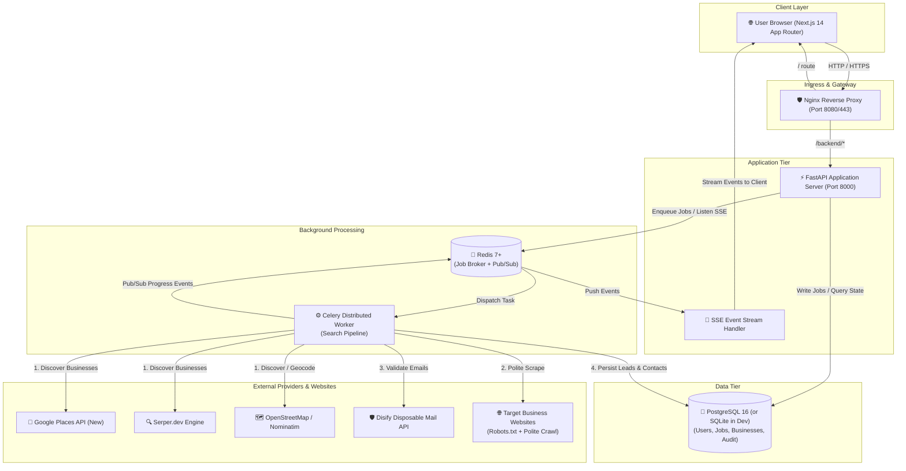
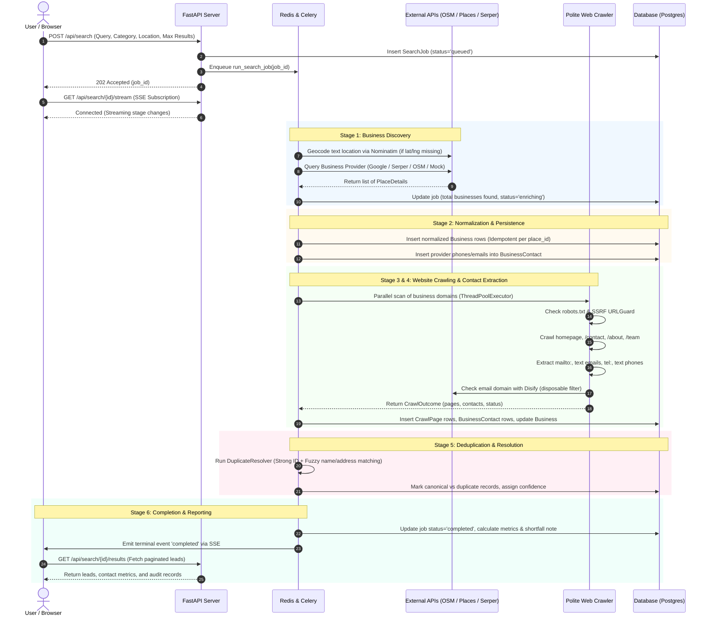
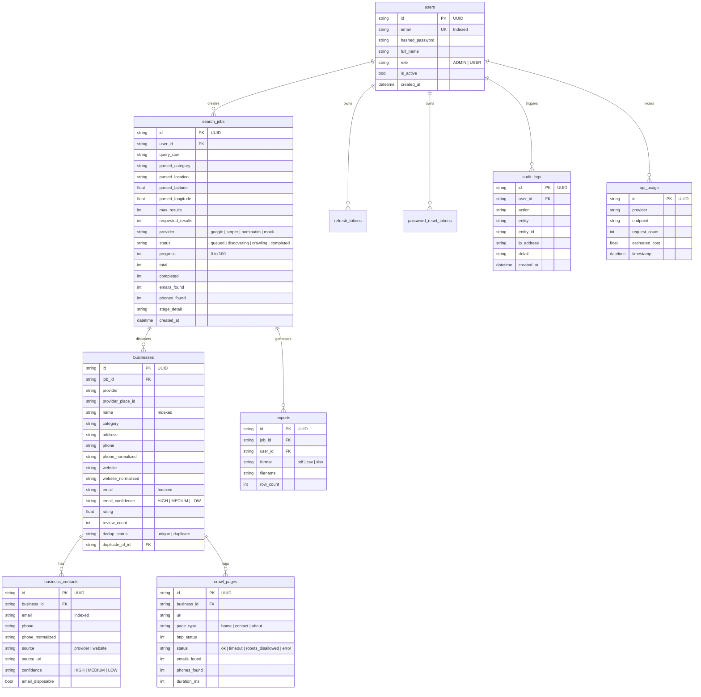

# LocalLead Intelligence — Complete Project Architecture & Working Guide

> **A comprehensive technical manual explaining all concepts, algorithms, data flows, and website functionalities of the LocalLead Intelligence platform.**

---

## Table of Contents

1. [Executive Summary & Core Concept](#1-executive-summary--core-concept)
2. [High-Level System Architecture](#2-high-level-system-architecture)
3. [The 6-Stage Asynchronous Pipeline](#3-the-6-stage-asynchronous-pipeline)
4. [Core Technical Concepts & Algorithms](#4-core-technical-concepts--algorithms)
   - [4.1 Natural Language Query Parsing](#41-natural-language-query-parsing)
   - [4.2 Multi-Provider Discovery & Intelligent Fallbacks](#42-multi-provider-discovery--intelligent-fallbacks)
   - [4.3 Polite & Compliant Web Crawler](#43-polite--compliant-web-crawler)
   - [4.4 Anti-SSRF Security Matrix](#44-anti-ssrf-security-matrix)
   - [4.5 Contact Enrichment & Disposable Email Filtering](#45-contact-enrichment--disposable-email-filtering)
   - [4.6 Confidence Scoring & Phone Normalization](#46-confidence-scoring--phone-normalization)
   - [4.7 Fuzzy Deduplication & Entity Resolution](#47-fuzzy-deduplication--entity-resolution)
   - [4.8 The "Requested vs. Available" Transparency Principle](#48-the-requested-vs-available-transparency-principle)
5. [Website Working & User Journey Walkthrough](#5-website-working--user-journey-walkthrough)
   - [5.1 Authentication & Role-Based Access Control](#51-authentication--role-based-access-control)
   - [5.2 Search Dashboard & Query Interpretation](#52-search-dashboard--query-interpretation)
   - [5.3 Live Streaming Progress (SSE + Redis Pub/Sub)](#53-live-streaming-progress-sse--redis-pubsub)
   - [5.4 Interactive Results View (Table & Card Grid)](#54-interactive-results-view-table--card-grid)
   - [5.5 Verification & Audit Drawer](#55-verification--audit-drawer)
   - [5.6 Multi-Format Export Engine (PDF, CSV, Excel)](#56-multi-format-export-engine-pdf-csv-excel)
   - [5.7 Search History & Job Management](#57-search-history--job-management)
   - [5.8 Admin Control Center & Telemetry](#58-admin-control-center--telemetry)
   - [5.9 User Profile & Settings](#59-user-profile--settings)
6. [Database Schema & Data Model](#6-database-schema--data-model)
7. [The Standalone LeadGen Engine (`leadgen/`)](#7-the-standalone-leadgen-engine-leadgen)
8. [Security, Governance & Operational Hardening](#8-security-governance--operational-hardening)
9. [Codebase Directory & File Reference](#9-codebase-directory--file-reference)
10. [Setup, Configuration & Execution Guide](#10-setup-configuration--execution-guide)

---

## 1. Executive Summary & Core Concept

**LocalLead Intelligence** is a production-grade, multi-tenant B2B local business lead-generation and commercial intelligence platform.

### The Problem It Solves
Finding verified, high-quality contact information for local businesses within specific geographical bounds (e.g., *"Hospitals in Porwal Road Pune"*, *"Societies in Kharadi"*, *"Schools in Viman Nagar"*) is traditionally painful, error-prone, or cost-prohibitive:
- Standard business APIs (like Google Places) provide company names, ratings, and occasionally a phone number, but almost **never provide email addresses**.
- General web scraping leads to broken links, disposable or stale email addresses, duplicate records, and high legal/security risks (SSRF, crawler abuse).
- Lead vendors often predict or synthesize emails without provenance, resulting in bounced cold outreach.

### The LocalLead Solution
LocalLead bridges this gap through a fully automated, 6-stage async pipeline:
1. **Discovers** businesses in any geographical target via multiple pluggable providers (**Google Places API (New)**, **Serper.dev**, or free open-source **OpenStreetMap / Nominatim**).
2. **Enriches** records by launching an ethical, polite web crawler against the businesses' official websites.
3. **Validates & Scores** contact points: extracts emails (`mailto:` and regex visible text), verifies emails against temporary/disposable mail detectors (**Disify**), normalizes phone numbers to standard **E.164** format, and calculates confidence ratings (`HIGH`, `MEDIUM`, `LOW`).
4. **Deduplicates** records using hybrid deterministic and fuzzy string matching algorithms to present a clean, canonical lead directory.
5. **Streams live progress** to an interactive modern dashboard via Server-Sent Events (SSE).
6. **Exports** branded, executive-ready PDF reports, CSV spreadsheets, and Excel sheets.

---

## 2. High-Level System Architecture

The platform is designed around a decoupled, microservice-ready architecture comprising an Nginx reverse proxy, a Next.js frontend, a FastAPI application server, Celery worker nodes, Redis for queues and pub/sub, and PostgreSQL for persistent storage.



### Component Details
- **Frontend (`frontend/`)**: Next.js 14 (App Router), TypeScript, Tailwind CSS, Lucide Icons, and custom UI micro-components. Employs a custom `useJobStream` hook for real-time SSE updates with automatic polling fallback.
- **Nginx (`infrastructure/nginx/`)**: Gateway handling TLS termination, gzip compression, request sanitization, routing `/` to the Next.js frontend and `/backend/*` to FastAPI.
- **Backend API (`backend/app/main.py`)**: Built with FastAPI. Provides OpenAPI/Swagger documentation (`/api/docs`), JWT bearer authentication with rotating refresh tokens, Pydantic v2 validation, and strict CORS configuration.
- **Celery Worker (`backend/app/workers/`)**: Executes asynchronous lead-generation jobs. Isolates errors at the per-business level so one failing site never crashes an entire search job.
- **Redis (`redis:6379`)**: Serves dual roles: message broker for Celery queues and real-time Pub/Sub channel (`locallead:job_events`) powering Server-Sent Events.
- **PostgreSQL Database (`postgres:5432`)**: ACID-compliant datastore managed with SQLAlchemy 2.0 ORM and Alembic migrations.

---

## 3. The 6-Stage Asynchronous Pipeline

When a user initiates a search, the backend creates a `SearchJob` record in the database, pushes the task ID to Celery via Redis, and returns an immediate `202 Accepted` response. The worker then executes the following sequential stages:



---

## 4. Core Technical Concepts & Algorithms

### 4.1 Natural Language Query Parsing
*File: `backend/app/services/query_parser.py`*

Users often type unstructured queries such as `"Hospitals in Porwal Road Pune"` or `"Schools near Viman Nagar"`. The platform parses these inputs into structured components without incurring slow or costly LLM API overhead:
- **Lexical Vocabulary Matching**: Contains a curated taxonomy of business categories (e.g., `hospital` $\rightarrow$ *"Hospitals"*, `dental clinic` $\rightarrow$ *"Dental Clinics"*, `petrol pump` $\rightarrow$ *"Petrol Pumps"*, `housing society` $\rightarrow$ *"Societies"*).
- **Positional & Prepositional Heuristics**: Identifies connective markers such as `in`, `near`, `at`, `around`, `across`, and `beside` to isolate the **Category** from the **Location**.
- **Confidence Rating**: Outputs `high`, `medium`, or `low` confidence. If ambiguous, the user can toggle structured mode in the UI to explicitly specify category and location.
- **Debounced Live Preview**: When typing in the search bar, the UI triggers a 300ms debounced call to `/api/search/interpret` to display what the backend will execute.

### 4.2 Multi-Provider Discovery & Intelligent Fallbacks
*Files: `backend/app/providers/`*

The platform abstracts business discovery behind an extensible `BusinessSearchProvider` interface:

```python
class BusinessSearchProvider(ABC):
    @abstractmethod
    def search_businesses(self, query: PlaceSearchQuery) -> list[PlaceDetails]: ...
    @abstractmethod
    def get_business_details(self, provider_place_id: str) -> Optional[PlaceDetails]: ...
    @abstractmethod
    def health_check(self) -> bool: ...
```

Supported Providers:
1. **Google Places API (New)** (`google_places.py`): Queries Google's modern Places API using **selective field masks** (e.g., `places.id,places.displayName,places.formattedAddress,places.websiteUri,places.nationalPhoneNumber,places.rating`). Requesting only the 13 required fields prevents unnecessary charges. Costs are tracked per call in the `api_usage` table.
2. **Serper.dev Provider** (`serper.py`): Queries the Google Maps scraper API at Serper.dev, extracting structured local pack data.
3. **OpenStreetMap / Nominatim Provider** (`nominatim.py`): A **100% free, keyless, open-source data provider**. Discovers businesses by querying OSM amenity/shop/office nodes and geocodes raw text addresses into exact latitude/longitude coordinates.
4. **Mock Provider** (`mock_provider.py`): Provides deterministic, offline test datasets with fault-injection simulation (`timeout`, `empty`, `error`) for tests and development without external dependencies.
5. **Provider Fallback Chain (`PROVIDER_FALLBACK_CHAIN`)**: If the primary provider (e.g. Google Places) exhausts its quota or encounters a 429/5xx error, the engine seamlessly degrades to the next configured provider (e.g., Serper or Nominatim). The results view explicitly informs the user if a fallback provider was used.

### 4.3 Polite & Compliant Web Crawler
*Files: `backend/app/crawlers/polite_fetcher.py`, `contact_finder.py`*

Once business discovery delivers official website URLs, the crawler enriches each lead by extracting emails and telephone numbers:
- **Scope Restriction**: Confined strictly to each business's own registrable domain (no following external third-party links).
- **Robots.txt Respect**: Fetches, parses, and caches `robots.txt` per origin. Disallowed paths are respected and logged as `robots_disallowed`.
- **Honest User-Agent**: Identifies itself transparently: `LocalLeadBot/1.0 (+https://locallead.ai/bot; compliant contact crawler)`.
- **Per-Domain Rate Limiting**: Employs a token-bucket rate limiter enforcing $\ge 2$ seconds between requests to the same domain.
- **Bounded Resource Limits**: Maximum 5 pages per domain, 12-second page timeout, 2MB max response stream cap, and HTML parsing via BeautifulSoup4 (no heavyweight headless browser needed).

### 4.4 Anti-SSRF Security Matrix
*File: `backend/app/utils/url_guard.py`*

Because crawlers fetch URLs parsed from untrusted websites, the system implements a strict **Server-Side Request Forgery (SSRF) Guard** (`URLGuard`):
- **Protocol Enforcement**: Only `http://` and `https://` schemes allowed.
- **Hostname Blacklist**: Blocks `localhost`, `*.internal`, `*.local`, `*.lan`, `metadata.google.internal`, `instance-data.ec2.internal`, etc.
- **Full Pre-Request DNS Resolution**: Resolves target hostnames to IP addresses before initiating a network request and verifies that the IP is not in any blocked CIDR block:
  - Loopback (`127.0.0.0/8`, `::1`)
  - Private networks RFC 1918 (`10.0.0.0/8`, `172.16.0.0/12`, `192.168.0.0/16`)
  - Carrier-Grade NAT (`100.64.0.0/10`)
  - Cloud Instance Metadata Service (`169.254.169.254`, `169.254.0.0/16`)
  - IPv6 link-local (`fe80::/10`), unique-local (`fc00::/7`), and IPv4-mapped IPv6.
- **Redirect Hop Re-validation**: Every HTTP redirect (`301`, `302`) is intercepted; the redirect destination URL is evaluated through the SSRF guard before the next request is made.

### 4.5 Contact Enrichment & Disposable Email Filtering
*Files: `leadgen/disify.py`, `backend/app/workers/pipeline.py`*

Emails parsed from websites can include spam traps or temporary addresses. LocalLead validates emails using **Disify**:
- Validates the domain against known disposable email providers (e.g., Mailinator, Yopmail, TempMail).
- If flagged as disposable, `email_disposable=True` is recorded, and the email's confidence is downgraded to `LOW`.
- Clean business emails (`info@company.com`, `contact@hospital.org`) retain `HIGH` or `MEDIUM` confidence.

### 4.6 Confidence Scoring & Phone Normalization
*Files: `backend/app/services/contact_normalizer.py`*

- **Confidence Tiers**:
  - `HIGH`: Direct email/phone provided by the business listing provider, or an email extracted from an explicit `mailto:` link on a dedicated `/contact` or `/about` page.
  - `MEDIUM`: Phone or email found in visible body text or footer of the website.
  - `LOW`: Email found on generic sub-pages, unverified text patterns, or addresses flagged by Disify.
- **Phone Normalization**: Standardizes raw phone strings (`+91 98220 12345`, `(020) 2665-4321`, `09822012345`) into international **E.164** format (`+919822012345`), recording country dialing codes and source provenance (`provider` vs `website`).

### 4.7 Fuzzy Deduplication & Entity Resolution
*File: `backend/app/services/deduplication.py`*

Data providers occasionally return the same business under minor name variations (e.g., *"Apollo Clinic"* vs *"The Apollo Clinic, Porwal Rd"*). The deduplication engine runs after extraction:
1. **Strong Identifiers** (Deterministic):
   - Identical normalized website domain.
   - Identical normalized E.164 phone number.
   - Identical provider place ID.
2. **Secondary Identifiers** (Probabilistic):
   - Computes string similarity on normalized names ($\text{sim}_{\text{name}}$) using Python's `SequenceMatcher`.
   - Computes string similarity on normalized addresses ($\text{sim}_{\text{addr}}$).
   - Weighted composite score: $\text{Score} = 0.6 \times \text{sim}_{\text{name}} + 0.4 \times \text{sim}_{\text{addr}}$.
3. **Action Thresholds**:
   - $\ge 0.85$: Marked as **Duplicate** (`dedup_status = "duplicate"`), linked to the canonical record (`duplicate_of_id`), and hidden from default views.
   - $0.60 - 0.84$: Flagged for review with audit reasoning.
   - $< 0.60$: Considered distinct unique businesses.

### 4.8 The "Requested vs. Available" Transparency Principle

A core principle of LocalLead is complete transparency: **Never pad fake data, never silently hide shortfalls.**
- If a user requests 50 leads, but Google Places or OSM only has 32 businesses in that specific geographical radius, the system returns all 32 and explicitly displays an informative banner:
  > *"Requested 50, showing 32 available — the data source returned fewer matches for this query."*
- If the platform maximum limit caps the search (e.g., requested 100, capped at 50), the system displays:
  > *"Requested 100; platform limit is 50 per search — showing all 50 available results."*

---

## 5. Website Working & User Journey Walkthrough

### 5.1 Authentication & Role-Based Access Control
*Routes: `/login`, `/register`, `/forgot-password`*

- **Registration**: New users register with email, password, and full name. Passwords are encrypted using **Argon2id** (with automatic bcrypt fallback).
- **Bootstrap Admin**: The **very first registered user** in an empty database is automatically assigned the `ADMIN` role. Subsequent users receive the `USER` role.
- **JWT Authentication**: On login, the API issues a short-lived **access token** (30 min) and sets a secure, HTTP-only **refresh token** (7 days) with reuse detection.
- **Forgot Password Flow**: Implements a secure token-based password reset with single-use hashed tokens that expire in 30 minutes.

### 5.2 Search Dashboard & Query Interpretation
*Route: `/dashboard`*

```
┌─────────────────────────────────────────────────────────────────────────────┐
│  LocalLead Intelligence — Commercial Lead Search                           │
├─────────────────────────────────────────────────────────────────────────────┤
│  [ Free-text Search ]   ( Structured Search )                              │
│                                                                             │
│  ┌─────────────────────────────────────────────────────────────┬─────────┐  │
│  │ 🔍 Hospitals in Porwal Road Pune                             │ Search  │  │
│  └─────────────────────────────────────────────────────────────┴─────────┘  │
│  ⚡ Live interpretation: Category: Hospitals · Location: Porwal Road, Pune  │
│                                                                             │
│  [▼] Advanced Options                                                       │
│      Max Results: [ 50 ]  Radius: [ 5,000m ]  Provider: [ Auto (Default) ]  │
│      [x] Respect robots.txt     [ ] Exclude disposable emails               │
└─────────────────────────────────────────────────────────────────────────────┘
```

1. **Free-text Mode**: Users type queries naturally. A live pill badge updates in real time indicating how the system interprets the category, location, and confidence.
2. **Structured Mode**: Offers explicit input fields for Category, City/Location, Search Radius (100m to 50,000m), Country Code, and Language.
3. **Provider Selector**: Allows choosing between `Auto` (server default with fallback), `Google Places`, `Serper`, `Nominatim (OpenStreetMap)`, or `Mock`.
4. **Execution**: Clicking **Start Search** sends `POST /api/search` and transitions immediately to the job tracking screen with a dynamic radar sweep animation.

### 5.3 Live Streaming Progress (SSE + Redis Pub/Sub)
*Hook: `frontend/hooks/useJobStream.ts`*

The frontend communicates with `/api/search/{jobId}/stream` using **Server-Sent Events**:
- Shows animated progress bars reflecting live percentages ($0\% \rightarrow 100\%$).
- Displays active stage indicators:
  - `queued` $\rightarrow$ *"Job queued in background"*
  - `discovering` $\rightarrow$ *"Searching businesses via OpenStreetMap / Google"*
  - `enriching` $\rightarrow$ *"Normalizing names, phones, and addresses"*
  - `crawling` $\rightarrow$ *"Scanning 42 business websites (2/s rate limit)"*
  - `extracting` $\rightarrow$ *"Extracting public email and phone records"*
  - `deduplicating` $\rightarrow$ *"Merging duplicate businesses"*
  - `completed` $\rightarrow$ *"Results ready"*
- **Resilience**: If the SSE connection drops or is blocked by an intermediary proxy, the `useJobStream` hook automatically falls back to polling `GET /api/search/{jobId}` every 2 seconds.

### 5.4 Interactive Results View (Table & Card Grid)
*Route: `/results/[jobId]`*

When the job completes, users are presented with a lead management interface:

```
┌─────────────────────────────────────────────────────────────────────────────┐
│  Hospitals in Porwal Road Pune               [ PDF Report ] [ CSV ] [ XLSX ]│
│  Status: Completed · 67 Found · 52 Websites · 39 Emails · 61 Phones         │
├─────────────────────────────────────────────────────────────────────────────┤
│  🔍 Filter leads...  [ Min 4★ Rating ] [ Has Email ] [ Has Phone ] [ Unique ]│
├─────────────────────────────────────────────────────────────────────────────┤
│  Business Name          Category    Rating  Phone         Email    Confidence│
│  ─────────────────────────────────────────────────────────────────────────  │
│  Lifeline Hospital      Hospitals   4.6 ★   +9198220...   info@...  [ HIGH ]│
│  Orchid Dental Clinic   Dentist     4.8 ★   +9120665...   care@...  [ HIGH ]│
│  Porwal Medical Center  Clinic      4.2 ★   +9198901...   contact@. [ MED  ]│
└─────────────────────────────────────────────────────────────────────────────┘
```

- **Metric Cards**: Real-time counter widgets showing total discovered leads, website coverage, valid emails found, verified phone numbers, and duplicate resolution count.
- **View Switching**: Toggle between a dense, sortable **Table View** and a visual **Card Grid View**.
- **Real-Time Client Filtering**: Instantly search by name, minimum star rating ($\ge 4.0$), leads with email only, leads with phone only, or high-confidence emails only.

### 5.5 Verification & Audit Drawer
Clicking any lead opens the **Business Verification Drawer**:
- Displays full business metadata (address, latitude/longitude, opening hours, Google Maps link).
- **Crawl Audit Trail**: Lists every individual URL visited on the business website, the HTTP status code (`200 OK`, `403 Forbidden`, `404 Not Found`), response time in milliseconds, and the `robots.txt` compliance outcome.
- **Contact Provenance**: Details where each phone number and email was located (e.g. *"Found via mailto: on /contact-us"* vs *"Extracted from footer text"*).
- **Disify Disposable Email Verdict**: Displays whether the email host is an authentic corporate domain or a temporary disposable inbox.

### 5.6 Multi-Format Export Engine (PDF, CSV, Excel)
*Routes: `/api/search/{id}/export/{format}`*

Users can export their intelligence reports in three formats:
1. **Executive PDF Report** (`pdf_report.py`): Built using **ReportLab Platypus**. Features a corporate cover section with search parameters, high-level metric cards, followed by a cleanly styled tabular directory with repeating headers, alternating row colors, contact confidence badges, and dynamic page numbering.
2. **CSV Export** (`csv_export.py`): Clean RFC 4180 CSV export formatted for direct import into CRMs like HubSpot, Salesforce, or Apollo.
3. **Excel Workbook** (`xlsx_export.py`): Formatted `.xlsx` file generated via `openpyxl` with styled header rows, column auto-sizing, and separate sheets for leads and crawl audit records.

### 5.7 Search History & Job Management
*Route: `/history`*

- Chronological list of all searches performed by the user.
- Displays query text, execution timestamp, delivered vs requested lead count, and status badges (`completed`, `failed`, `cancelled`).
- Actions: One-click export download, view results, or permanent deletion.

### 5.8 Admin Control Center & Telemetry
*Route: `/admin` (Restricted to `ADMIN` users)*

A centralized mission control for platform operators:
- **System Health Monitor**: Live health check gauges for PostgreSQL connectivity, Redis latency, Celery worker concurrency, and Business Provider status.
- **API Usage & Cost Accounting**: Tracks billable API queries made to Google Places, Serper, and Nominatim. Displays estimated spend for the current day and billing month.
- **Global Job Supervision**: View, inspect, or cancel running jobs across all platform users.
- **User Management**: Activate/deactivate accounts and promote users to `ADMIN` or demote to `USER`.
- **Security Audit Logs**: Immutable trail recording user logins, role changes, job creation, and export downloads with timestamps and client IP addresses.

### 5.9 User Profile & Settings
*Route: `/settings`*

- Displays account profile, role privileges, and assigned permissions.
- Direct link to password rotation via the secure reset flow.
- Compliance disclosures regarding ethical data collection and `robots.txt` guidelines.

---

## 6. Database Schema & Data Model

The relational datastore is structured around clean foreign-key cascades and explicit indices:



---

## 7. The Standalone LeadGen Engine (`leadgen/`)

In addition to the web app, the repository includes `leadgen`, an **open-source OSINT lead generation engine** that runs directly from the command line:

```bash
python3 -m leadgen --category "Hospital" --location "Pune" --limit 20 --export csv
```

### Module Breakdown:
- **`leadgen/__main__.py`**: CLI entry point with arguments for category, location, bounding box coordinates, output format, and concurrency settings.
- **`leadgen/pipeline.py`**: Lightweight synchronous orchestration pipeline for standalone use.
- **`leadgen/geocode.py`**: Pure OpenStreetMap geocoding via Nominatim with REST Countries fallback (zero Google dependencies).
- **`leadgen/siteintel.py`**: Website metadata analyzer extracting page titles, social links (LinkedIn, Twitter, Facebook, Instagram), and CMS signatures.
- **`leadgen/disify.py`**: Standalone client for Disify disposable-email verification.
- **`leadgen/numverify.py`**: International phone number validation and carrier identification.
- **`leadgen/dedup.py`**: Standalone scoring and record deduplication.
- **`leadgen/audit.py`**: Generates a self-contained JSON/SQLite audit trail recording HTTP status codes, latency, and compliance status for every network call.

---

## 8. Security, Governance & Operational Hardening

1. **Authentication Security**:
   - Passwords hashed with **Argon2id**.
   - Cryptographically random JWT secrets (`SECRET_KEY`).
   - Refresh tokens stored as SHA-256 hashes with automatic token family invalidation if a reused token is detected.
2. **Strict Network & Injection Defenses**:
   - Pre-request SSRF validation on every crawler URL.
   - Pydantic v2 validation on 100% of request bodies and query parameters.
   - All database queries executed via SQLAlchemy parameterized queries (prevents SQL injection).
3. **Application Rate Limiting**:
   - IP-based rate limiting on sensitive auth endpoints (`/login`, `/register`, `/forgot-password`).
   - User-based limits on job creation (`SEARCH_RATE_LIMIT=10/minute`).
   - General API client rate limiting.
4. **Zero-Leak Logging (`SecretsFilter`)**:
   - The logging subsystem scans all structured log events and redacts sensitive environment keys (`SECRET_KEY`, API tokens, database passwords) before writing to console or disk.
5. **Browser Security Headers**:
   - Middleware sets `Content-Security-Policy`, `X-Content-Type-Options: nosniff`, `X-Frame-Options: DENY`, `Strict-Transport-Security` (in production), and `Referrer-Policy: strict-origin-when-cross-origin`.

---

## 9. Codebase Directory & File Reference

```
Lead_Generation-main/
├── README.md                     # Developer quickstart and production handoff
├── PROJECT_EXPLANATION.md        # This comprehensive concepts & architecture manual
├── docker-compose.yml            # Multi-container orchestration (Nginx, API, Worker, DB, Redis)
├── requirements.txt              # Production Python dependencies
│
├── backend/                      # FastAPI Application & Celery Backend
│   ├── app/
│   │   ├── main.py               # FastAPI entrypoint, middlewares, router mounting
│   │   ├── api/                  # REST API Endpoints
│   │   │   ├── auth.py           # Login, registration, token refresh, password reset
│   │   │   ├── search.py         # Search creation, query preview, results, SSE streaming
│   │   │   ├── business.py       # Single business detail & audit lookup
│   │   │   ├── exports.py        # PDF, CSV, and XLSX generation & download
│   │   │   ├── admin.py          # Platform telemetry, user management, audit logs
│   │   │   └── health.py         # Deep healthchecks (DB, Redis, Celery, Provider)
│   │   ├── core/                 # Settings, security, rate limiters, startup validation
│   │   ├── crawlers/             # Website contact discovery & polite crawler
│   │   │   ├── polite_fetcher.py # Robots.txt, rate limits, timeout controls
│   │   │   └── contact_finder.py # Email regex, mailto parsing, phone extraction
│   │   ├── exports/              # ReportLab PDF, CSV, openpyxl XLSX generators
│   │   ├── models/               # SQLAlchemy ORM database models
│   │   ├── providers/            # Business discovery adapters
│   │   │   ├── google_places.py  # Google Places API (New) with selective field masks
│   │   │   ├── serper.py         # Serper.dev Google Maps engine
│   │   │   ├── nominatim.py      # OpenStreetMap geocoder & business discovery
│   │   │   └── mock_provider.py  # Deterministic test data provider
│   │   ├── services/             # Query parsing, phone normalization, deduplication
│   │   ├── utils/                # SSRF url_guard, date utilities
│   │   └── workers/              # Celery application & 6-stage async pipeline
│   └── tests/                    # Comprehensive test suite (135+ tests)
│
├── frontend/                     # Next.js 14 Web Application
│   ├── app/
│   │   ├── (app)/                # Authenticated Application Shell
│   │   │   ├── dashboard/        # Main search screen & live radar progress
│   │   │   ├── results/[jobId]/  # Table/Grid lead browser & audit drawer
│   │   │   ├── history/          # Historical search directory
│   │   │   ├── admin/            # Mission control & usage telemetry
│   │   │   └── settings/         # User profile & compliance info
│   │   ├── login/                # Authentication screen
│   │   ├── register/             # User sign-up screen
│   │   └── layout.tsx            # Global layout, fonts, and dark theme
│   ├── components/ui/            # Cards, badges, radar pulse, data tables
│   ├── hooks/useJobStream.ts     # Resilient SSE streaming hook with poll fallback
│   └── lib/api.ts                # Axios/fetch API client with JWT refresh interceptors
│
├── leadgen/                      # Standalone CLI OSINT Lead Generation Engine
│   ├── __main__.py               # CLI interface
│   ├── pipeline.py               # Standalone extraction pipeline
│   ├── geocode.py                # OpenStreetMap geocoding
│   ├── siteintel.py              # Website metadata & social profile scraper
│   └── disify.py                 # Disposable email checking
│
├── infrastructure/               # Infrastructure assets
│   └── nginx/                    # Nginx configuration & reverse proxy rules
└── docs/                         # Specialized technical documentation
    ├── architecture.md           # Architecture diagrams & pipeline specs
    ├── CRAWLER.md                # Crawling ethics, limits, and SSRF rules
    ├── DATA_SOURCES.md           # Provider capabilities & cost models
    ├── SECURITY.md               # Security architecture & threat model
    └── PRODUCTION_CHECKLIST.md   # Deployment verification checklist
```

---

## 10. Setup, Configuration & Execution Guide

### Method A: Docker Compose (Recommended)

The easiest way to run the entire stack (Nginx, Next.js, FastAPI, Celery, PostgreSQL, Redis) with zero manual environment configuration:

```bash
# 1. Clone repository and navigate to root
cd Lead_Generation-main

# 2. Copy the environment template
cp .env.example .env

# 3. Open .env and set your SECRET_KEY (e.g. openssl rand -hex 32)
# By default, BUSINESS_PROVIDER=mock allows instant running with zero paid API keys!

# 4. Build and start all services
docker compose up --build
```

#### Access Points:
- **Web Application**: [http://localhost:8080](http://localhost:8080) (via Nginx) or [http://localhost:3000](http://localhost:3000) (Next.js direct)
- **API Documentation (Swagger)**: [http://localhost:8000/api/docs](http://localhost:8000/api/docs)
- **Health Check Endpoint**: [http://localhost:8000/api/health](http://localhost:8000/api/health)

> **First Login**: Click **Create Account** on the web app. The very first registered user is automatically granted **ADMIN** privileges!

---

### Method B: Local Development (Without Docker)

#### 1. Backend Setup:
```bash
cd backend
python3 -m venv .venv
source .venv/bin/activate
pip install -r requirements.txt -r requirements-dev.txt

# Configure local development environment
export DATABASE_URL="sqlite:///./locallead_dev.db"
export BUSINESS_PROVIDER="mock"  # or 'nominatim' for free real data
export SECRET_KEY="dev-secret-key-change-in-production"

# Apply database migrations
alembic upgrade head

# Run FastAPI server
uvicorn app.main:app --reload --port 8000
```

#### 2. Background Worker (In a separate terminal):
```bash
cd backend
source .venv/bin/activate
# Requires Redis running locally on port 6379
celery -A app.workers.celery_app.celery_app worker --loglevel=INFO
```

#### 3. Frontend Setup:
```bash
cd frontend
npm install
npm run dev
# App will run at http://localhost:3000
```

---

### Method C: Enabling Live Real-World Data

To switch from mock data to real-world business listings:

1. **Free / Keyless Option (OpenStreetMap)**:
   In `.env`:
   ```bash
   BUSINESS_PROVIDER=nominatim
   ENABLE_NOMINATIM_GEOCODE=true
   ```
2. **Google Places API (New)**:
   In `.env`:
   ```bash
   BUSINESS_PROVIDER=google
   GOOGLE_MAPS_API_KEY=your_google_cloud_api_key_here
   ```
3. **Serper.dev Engine**:
   In `.env`:
   ```bash
   BUSINESS_PROVIDER=serper
   SERPER_API_KEY=your_serper_key_here
   ```
4. **Intelligent Fallback Chain**:
   ```bash
   PROVIDER_FALLBACK_CHAIN=google,serper,nominatim
   ```
   If Google runs out of quota or encounters an error, the system automatically falls back to Serper, and then to Nominatim, ensuring searches never fail.
